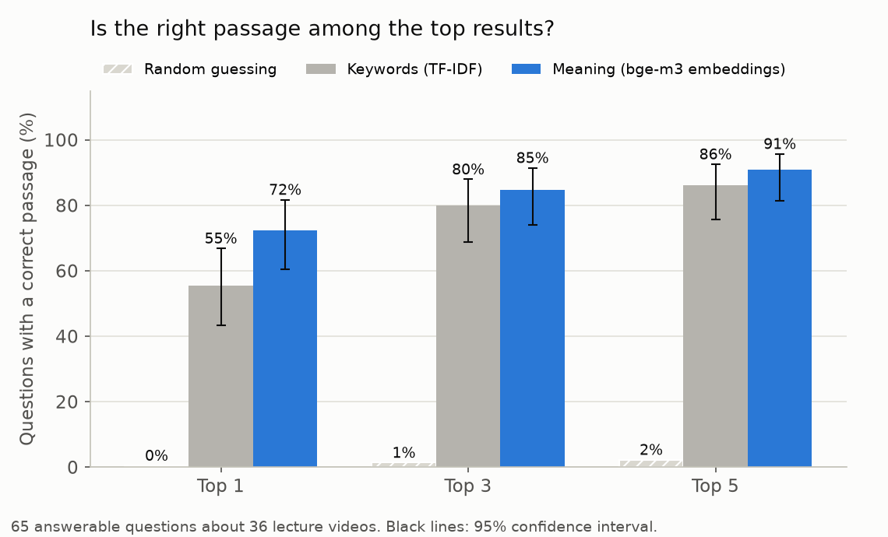
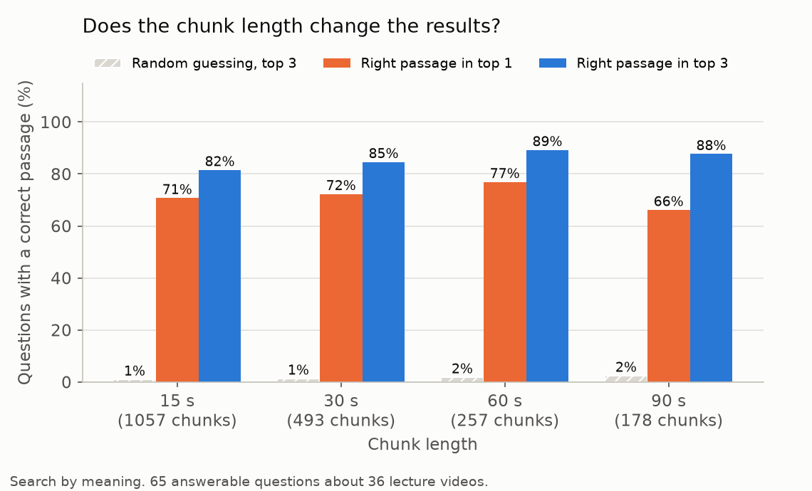
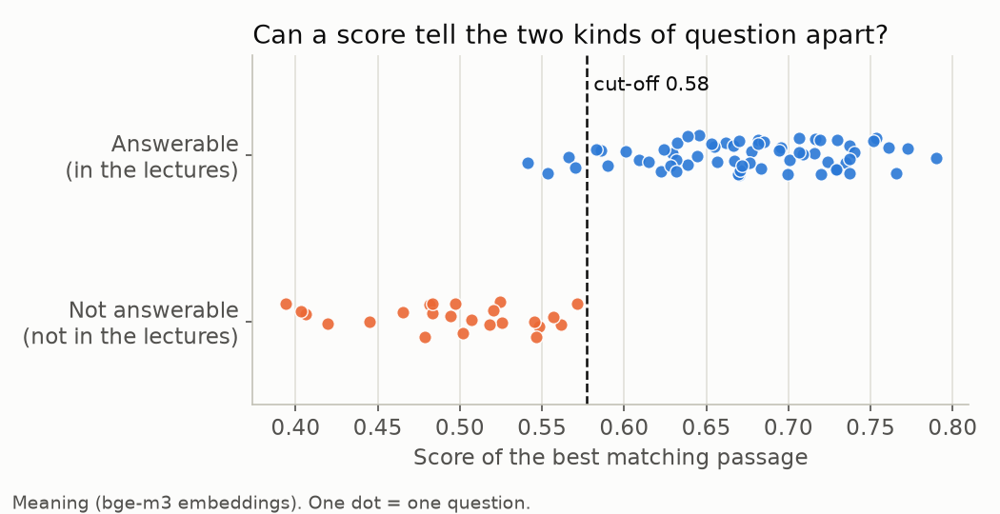

# Lecture Search Assistant


Ask a question, and the assistant tells you **which lecture video and which minute** answers it. It is a small RAG (retrieval-augmented generation) system over 36 lectures of MIT's *The Analytics Edge* (linear and logistic regression, trees, text analytics). Whisper turns the speech into text with timestamps, an embedding model makes the text searchable by meaning, and a local LLM writes a short answer from the passages it finds. If nothing in the lectures matches, it says so instead of guessing.

**Result in one line:** on 65 test questions with marked answers, the right passage is among the top 3 results for 85% of the questions (95% confidence interval 74-91%), against 80% for keyword search and 1% for random guessing. A tuned cut-off lets it answer 94% of the answerable questions and refuse the 24 that the lectures cannot answer. The questions are few and were drafted with an AI assistant, so read the caveats under *Key findings* and *Limitations*.

<!-- After you run the app, save a screenshot as images/app_screenshot.png and remove the comment marks around the next line.

-->

## Results

<!-- RESULTS:START -->

**Test questions:** 65 questions that the 36 lecture videos answer (206 minutes of speech; `eval/questions.csv` says where each answer is said) and 24 questions that they cannot answer (unrelated, or about topics the selected lectures do not cover). Chunks are about 30 s long with 5 s overlap (493 chunks). A result is correct if it comes from the right video and overlaps the time where the answer is said.

#### Keyword search vs search by meaning

| Search method | Recall@1 | Recall@3 | Recall@5 |
|---|---|---|---|
| Random guessing (calculated) | 0% | 1% | 2% |
| Keywords (TF-IDF) | 55% (43-67) | 80% (69-88) | 86% (76-93) |
| Meaning (bge-m3 embeddings) | 72% (60-82) | 85% (74-91) | 91% (81-96) |

Recall@k = share of the answerable questions whose right passage is among the top k results. The range in brackets is the 95% confidence interval (Wilson). 'Random guessing' is the exact chance that k chunks picked at random contain the answer, so it shows how much of a result could be luck.
With 65 questions the interval is about +/-9 points around each percentage, so a gap smaller than that between two rows is not a reliable difference.



#### Chunk length (search by meaning)

| Chunk length | Chunks | Recall@1 | Recall@3 | Recall@5 | Random guessing, Recall@3 |
|---|---|---|---|---|---|
| 15 s (overlap 3 s) | 1057 | 71% | 82% | 88% | 1% |
| 30 s (overlap 5 s) | 493 | 72% | 85% | 91% | 1% |
| 60 s (overlap 10 s) | 257 | 77% | 89% | 92% | 2% |
| 90 s (overlap 15 s) | 178 | 66% | 88% | 94% | 2% |

A result counts as correct when it overlaps the answer, so longer chunks have an easier job: look at how the random column grows. They also point to a coarser spot in the video.



#### The 'not found' cut-off

| Search method | Cut-off | Answerable questions answered | Other questions refused | Balance on unseen questions |
|---|---|---|---|---|
| Meaning (bge-m3 embeddings) | 0.58 | 94% | 100% | 94% (+/- 6) |
| Keywords (TF-IDF) | 0.20 | 78% | 88% | 80% (+/- 9) |

The cut-off is the lowest score at which the assistant still answers. I chose it on these same questions, so the middle two columns are a little optimistic. The last column picks the cut-off on some questions and tests it on others (5-fold, repeated 10 times), which is the fairer number.



<!-- RESULTS:END -->

## Key findings

- **Search by meaning is ahead mostly at the first position.** The right passage is the top result for 72% of the questions with embeddings and 55% with keywords (random guessing: 0%). In the top 3 and top 5 the gap shrinks to 5 points (85% vs 80%, 91% vs 86%), which is inside the +/-9 points of uncertainty, so those rows are not clearly different. Even the 17-point gap at the first position has intervals that overlap a little: with 65 questions it is a strong hint, not a proof.
- **Chunk length changes little.** Recall@3 is 82% for 15 s, 85% for 30 s, 89% for 60 s and 88% for 90 s chunks, all within the noise. Longer chunks also have an easier job (random guessing goes from 1% to 2%) and point to a coarser spot in the video, so I kept 30 s.
- **The "not found" cut-off works, with a thin margin.** At 0.58 the assistant answers 94% of the answerable questions and refuses all 24 others, including 14 near misses on topics the selected lectures do not cover (for example clustering). On questions it was not tuned on the estimate is 94% (+/- 6). The scores of the two groups overlap a little: 4 answerable questions fall below the cut-off, and the best-scoring unanswerable question lands just under it.
- **The mistakes are mostly near misses.** For 10 of the 65 questions the right passage was not in the top 3. In 6 of them the right lecture was still among the top 3 results, and in 3 a result started or ended within 30 seconds of the marked answer, so a viewer would find it right there. Recall counts only the marked passage, so it understates how useful those results are. The other 4 mixed up neighbouring topics (for example two questions about CART and R code).
- **A tool bug slowed the run.** `bge-m3` in Ollama sometimes answers `NaN` for a text. The code retries such texts with the smallest change that works and logs it: 1 of 493 chunks and 1 of 89 questions in the main test (see the note under *Run it*).


## How it works

```
lecture video  ->  Whisper  ->  text with timestamps  ->  chunks of about 30 seconds
                                                               |
                                 embeddings (bge-m3, via Ollama)
                                                               v
question  ->  embedding  ->  cosine similarity  ->  best passages
                                                               |
                best score below the cut-off?  -->  "Not found in the videos"
                                                               |
                     otherwise:  llama3.2 writes a short answer, sources shown with timestamps
```

0. **Download** (`step0_download_videos.py`). Gets the chosen lectures from the Internet Archive. A stopped download continues where it stopped, and every finished file is compared with the size and MD5 checksum that archive.org publishes.
1. **Transcribe** (`step1_transcribe.py`). Whisper (`small.en`, English only) reads each video and returns text with start and end times. MIT publishes transcripts too, but only as PDFs without timestamps, and the timestamps are what lets this project point to the minute.
2. **Chunk and embed** (`step2_build_index.py`). Whisper's own segments are only a few seconds long, too short to hold a whole idea, so neighbouring segments are joined into chunks of about 30 seconds that overlap by 5 seconds. Each chunk is turned into a list of 1,024 numbers (an embedding) by the `bge-m3` model. Chunks with similar meaning get similar numbers.
3. **Search** (`ask.py` or `app.py`). The question gets an embedding too. The chunks whose numbers are closest to the question (highest cosine similarity) are the answer candidates.
4. **Say "not found"** when the best score is below a cut-off. Without this, the LLM would be handed unrelated passages for every question, and it tends to invent an answer from them.
5. **Answer.** Otherwise `llama3.2` (running on my laptop through Ollama) writes 2 to 4 sentences using only the found passages. The sources are always shown next to the answer, with the lecture, its place in the course and the time range. In the web app, the video player opens at that second.
6. **Evaluate** (`evaluate.py`). It uses test questions about the lectures, each with the time range where the answer is said. The script measures how often the right passage is in the top results, compares search by meaning with plain keyword search **and with random guessing**, gives a 95% confidence interval for every percentage, tries four chunk lengths and picks the "not found" cut-off.

## The lectures

[MIT OpenCourseWare 15.071 *The Analytics Edge*](https://ocw.mit.edu/courses/15-071-the-analytics-edge-spring-2017/) (Spring 2017, Prof. Dimitris Bertsimas), licensed [CC BY-NC-SA 4.0](https://creativecommons.org/licenses/by-nc-sa/4.0/). The course has 82 short videos in units 2 to 5; they are listed in `catalog.csv`.

I use **36 of them (about 400 MB)**, the ones that explain an idea: what a method is, how to read its output, how to judge it. I left out the story and introduction videos, most of the R walk-throughs and the summaries. That keeps the download and the transcription time reasonable, and it makes a useful test: the lectures that are *not* used still cover related topics, so a question about them has to be refused, not answered with a nearly-right passage.

One video, 2.3-V3 (*Predicting Runs*), has no sound in the archive.org file, so `catalog.csv` uses 2.3-V4 (*Using the Models to Make Predictions*) in its place.

`catalog.csv` also holds, for every chosen video, a few words that must appear in its transcript (`check_regex`). `step1_transcribe.py` warns if a transcript contains none of them, which would mean that a file does not belong to its title.

## What is different from the course version

This project started from the RAG exercise in the course (see credits). What I changed:

- **A real, public set of lectures** instead of a private video set, with a download step that verifies every file.
- **Chunks of about 30 seconds** instead of Whisper's raw 2 to 3 second segments, with overlap so an answer is not cut in half.
- **A "not found" cut-off**, tuned on questions that the lectures cannot answer. The course version always passes the top 4 passages to the LLM.
- **Evaluation with a yardstick.** Recall@1, 3 and 5 on questions with marked answers, compared with the exact chance of finding the answer by random guessing, a keyword-search baseline (TF-IDF), 95% confidence intervals, a comparison of four chunk lengths, and a cross-validated estimate for the cut-off.
- **Sources with timestamps** and a web app (Streamlit) that plays the video from the right second.
- **Clear error messages** (Ollama not running, model not downloaded, wrong file names, a Whisper install that cannot read audio) and `check_setup.py` to see what is missing.
- **Safe index files:** `chunks.csv` and `embeddings.npy` instead of a pickle file.
- **Tests** that run without Whisper, Ollama or internet, using a fake embedder, a fake Ollama server and a fake archive.org server.

## Project structure

```
├── step0_download_videos.py   # lecture videos from archive.org (resumable, checksum-verified)
├── step1_transcribe.py        # videos -> transcripts (Whisper)
├── step2_build_index.py       # transcripts -> chunks + embeddings
├── ask.py                     # ask a question in the terminal
├── app.py                     # ask a question in the browser (Streamlit)
├── evaluate.py                # measure the search, make the charts above
├── check_setup.py             # shows what is installed and what to do next
├── grep_transcripts.py        # where do the lectures say a word? what is said at 0:30-1:10?
├── rag.py                     # the functions behind all of the above
├── config.py                  # every setting in one place
├── catalog.csv                # the 82 lectures: id, title, file name on archive.org, chosen or not
├── eval/
│   ├── questions.csv          # my test questions and where each answer is said
│   ├── HOW_TO_WRITE_QUESTIONS.md
│   ├── results.md             # numbers from the last evaluation
│   └── failures.csv           # questions where the right passage was not in the top 3
├── images/                    # charts made by evaluate.py
├── tests/                     # pytest tests (no Whisper, Ollama or internet needed)
├── .github/workflows/         # runs the tests on GitHub at every push (the badge at the top)
├── .streamlit/config.toml     # settings of the web app (it starts at once, without asking for an e-mail address)
├── .vscode/                   # Run and Debug configurations for VS Code (see "In VS Code" below)
├── requirements.txt
├── NOTICE.md                  # credits and licenses
├── LICENSE                    # MIT, for my code and questions
└── README.md
```

Not in the repository, because they are other people's work: the videos (`videos/`), their transcripts (`transcripts/`) and the search index built from them (`index/`). Steps 0 to 2 rebuild all three.

## Run it

```
pip install -r requirements.txt
pip install faster-whisper "av<19"  # only for step 1. With a GPU use "pip install openai-whisper" (needs ffmpeg) instead
ollama pull bge-m3                  # the embedding model
ollama pull llama3.2                # the LLM that writes the answers

python check_setup.py               # tells you what is missing and what to do next
python step0_download_videos.py     # about 400 MB
python step1_transcribe.py --only 3.2-V5    # try ONE video first and read transcripts/3.2-V5.txt
python step1_transcribe.py                  # then all of them (slow on a CPU: the trial run shows how slow)
python step2_build_index.py
python ask.py "what is an ROC curve?"
streamlit run app.py
python evaluate.py --write-readme   # needs the questions in eval/questions.csv; about 45 minutes on my laptop
```

Why `"av<19"`: faster-whisper reads the audio with the `av` package, and `av` 19 removed an option that faster-whisper 1.2.1 still passes, so every video failed with `unexpected keyword argument 'metadata_errors'`. `check_setup.py` and step 1 now test this first, so you hear about it in a second and not after the model download.

**Ollama says `unsupported value: NaN` while embedding?** Some Ollama versions run `bge-m3` with flash attention, which overflows for a few texts. The usual fix is to update Ollama, or to set the environment variable `OLLAMA_FLASH_ATTENTION=false` and restart it (I have not tried either). Without such a fix the code still finishes: when a batch fails it sends the texts one by one, and for a text that still fails it makes the smallest change that works (a full stop at the end, a few words dropped from the start or the end, or, rarely, only one half of the text). Every change is printed and saved in `index/settings.json` under `embed_changed`. In my runs it affected 1 of 493 chunks and 1 of 89 questions in the main test, and 47 of 1,057 chunks in the 15-second test. It makes embedding slower: a failing batch of 32 texts takes about a minute, and the whole evaluation took 44 minutes on my laptop.

**Windows with more than one Python (for example Anaconda as well)?** Write `python -m pip install ...` instead of `pip install ...`, so that the packages go to the same Python that runs the scripts. `python check_setup.py` prints which Python that is, on its first line.

Settings such as the Whisper model, chunk length and the "not found" cut-off are in `config.py`. The web app also works without Ollama: it then offers keyword search only.

The videos are about 400 MB. If your project folder is inside OneDrive, keep them outside it by setting the folder before step 0. On Windows, once for good (then open a new terminal): `setx LECTURE_VIDEO_DIR D:\lecture_videos`. For the current window only: PowerShell `$env:LECTURE_VIDEO_DIR = "D:\lecture_videos"`, Command Prompt `set LECTURE_VIDEO_DIR=D:\lecture_videos`. Steps 0, 1 and the app all read that variable.

To run the tests: `pip install pytest`, then `python -m pytest`. GitHub runs them on Python 3.10, 3.12 and 3.14 at every push.

**In VS Code:** open this folder and accept the recommended extensions. Press `F5` (Run and Debug) and pick a configuration: check the setup, download, transcribe, build the index, ask, evaluate, the web app or the tests. They are defined in `.vscode/launch.json`. Use `Ctrl+F5` for the long steps, which run faster without the debugger.

## Data and credits

- **Lectures:** MIT OpenCourseWare, *15.071 The Analytics Edge*, Spring 2017, Prof. Dimitris Bertsimas, [CC BY-NC-SA 4.0](https://creativecommons.org/licenses/by-nc-sa/4.0/). Source: <https://ocw.mit.edu/courses/15-071-the-analytics-edge-spring-2017/>. The videos are downloaded from the Internet Archive item `MIT15.071S17`. This project is not affiliated with or endorsed by MIT. See `NOTICE.md`.
- **Idea and first pipeline:** the RAG project from CodeWithHarry's *Ultimate Job Ready Data Science* course (Whisper, `bge-m3` embeddings and `llama3.2` through Ollama).
- **Models, not included:** [Whisper](https://github.com/openai/whisper) (MIT license), optionally through [faster-whisper](https://github.com/SYSTRAN/faster-whisper) (MIT license), [BGE-M3](https://huggingface.co/BAAI/bge-m3) (MIT license) and [Llama 3.2](https://www.llama.com/llama3_2/license/) (Llama 3.2 Community License), all run locally through [Ollama](https://ollama.com) or Python.
- **My work:** the download step with verification, the chunking, the "not found" cut-off, the evaluation with its baselines and confidence intervals, the web app, the tests and the questions with marked answers.
- **Code license:** MIT (see `LICENSE`). It covers my code and my questions, not the lectures.

## Limitations and next steps

- **Small and narrow data.** 36 lectures on one course, one speaker (plus a few teaching assistants in the recitation videos). The search would face much harder choices with hundreds of lectures on many topics.
- **The questions were drafted with an AI assistant**, working from the transcripts and before the first evaluation run. Each marked time range was then checked against the transcript text. Because they were written after reading the transcripts, the words in the questions can be close to the words in the lectures. This helps both search methods, keyword search more than search by meaning. Questions written by other people would be a harder and fairer test.
- **Recall is a lower bound.** Only the marked passage counts as correct. When the same idea is explained in two places (a recap, or the start of the next video), a good result from the other place counts as a miss.
- **Few questions mean wide intervals.** The confidence intervals in the tables are the honest way to read them: two methods whose intervals overlap are not clearly different.
- **Whisper makes mistakes** with technical terms (for example `glm`, `CART`, `minbucket`). I did not correct the transcripts by hand, so the evaluation measures the real pipeline. `faster-whisper` and `openai-whisper` give slightly different text for the same video, so a rebuilt transcript will not be identical to mine, but the marked time ranges still apply.
- **The cut-off was tuned on the same questions** that are reported, and its margin is thin (see *Key findings*). The cross-validated number is the fairer estimate, but only new questions could confirm it.
- **The evaluation measures the search, not the written answers.** Whether `llama3.2` words an answer correctly would have to be graded by hand. A small LLM can also ignore its instructions, which is why the sources are always shown.
- Next: hybrid search (keywords and meaning together, merged with reciprocal rank fusion), other embedding models, a topic hint for Whisper to spell technical terms better, a re-ranking step, and a held-out set of questions that I do not look at while tuning.
